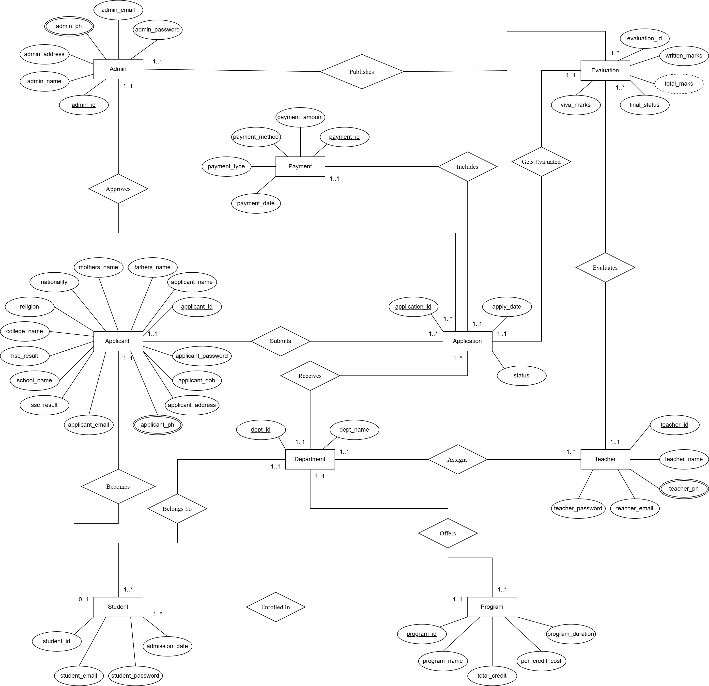

# University Admission Management System

**[View the full Project Report (PDF)](docs/project-report.pdf)**

An **Oracle SQL and PL/SQL academic database project** that models the admission process from applicant registration and application review to payment tracking, evaluation, and student enrollment.

Developed for **Advance Database Management System, Section C, Fall 2025–2026** at **American International University-Bangladesh (AIUB)**.

[Setup guide](docs/setup.md) · [Database reference](docs/database.md) · [Project report](docs/project-report.pdf)

## Project scope

This repository contains the database schema, sample data, PL/SQL exercises, and database design documents.

The database demonstrates:

- **Applicant records:** personal details, academic results, and contact information.
- **Application processing:** submission dates, review status, reviewing admins, and departments.
- **Payment tracking:** application fees, payment methods, dates, and amounts.
- **Admission evaluation:** written and viva marks, teachers, and final outcomes.
- **Student enrollment:** links between admitted applicants, departments, and programs.
- **Database programming:** functions, procedures, records, cursors, triggers, packages, and exception handling.

## Admission workflow

1. An applicant provides personal and academic information.
2. An application is associated with the applicant and a department.
3. A payment is recorded against the application.
4. An administrator reviews the application.
5. A teacher evaluates written and viva performance; an administrator publishes the result.
6. A selected applicant is recorded as a student in a department and program.

This is the modeled business workflow. The scripts demonstrate individual database operations; they do not automatically enforce or execute every transition.

## Technology and tools

| Area | Technology |
| --- | --- |
| Database | Oracle Database |
| Query language | SQL |
| Database programming | Oracle PL/SQL |
| Script execution | SQL Developer, SQLcl, or SQL*Plus |
| Database diagrams | diagrams.net / draw.io |
| Documentation | PDF and Word documents |

No specific Oracle release is pinned in the original project. See the [setup guide](docs/setup.md) for connection requirements and execution instructions.

## Database design

The schema has **9 tables**, **9 sequences**, primary and foreign keys, and unique constraints on email addresses and department names.

| Table | Purpose |
| --- | --- |
| `Admin` | Administrators responsible for application review and result publication |
| `Applicant` | Applicant identity, contact details, and SSC/HSC results |
| `Department` | Academic departments |
| `Program` | Department programs, credits, costs, and duration |
| `Teacher` | Department teachers who evaluate applications |
| `Application` | Admission submissions linked to applicants, departments, and admins |
| `Payment` | Payment records linked to applications |
| `Evaluation` | Written/viva results linked to applications, teachers, and admins |
| `Student` | Enrollment records linked to applicants, departments, and programs |

### Entity relationship diagram



[Editable ER diagram](docs/diagrams/er-diagram.drawio) · [Schema diagram](docs/diagrams/schema-diagram.png) · [Editable schema](docs/diagrams/schema-diagram.drawio)

The normalization documents describe the progression from UNF through 3NF. The [database reference](docs/database.md) documents the implemented columns and differences between the conceptual model and SQL constraints.

## SQL and PL/SQL examples

| Script | Contents |
| --- | --- |
| [`01_schema_and_seed.sql`](sql/01_schema_and_seed.sql) | Sequences, tables, constraints, 62 sample rows, and inspection queries |
| [`02_basic_plsql.sql`](sql/02_basic_plsql.sql) | 16 examples covering variables, operators, functions, loops, conditions, subqueries, and joins |
| [`03_advanced_plsql.sql`](sql/03_advanced_plsql.sql) | 16 examples covering stored functions/procedures, records, cursors, row/statement triggers, and packages |
| [`04_exception_handling.sql`](sql/04_exception_handling.sql) | Versions of the advanced examples with exception handling |

Named objects include:

- `total_depts` and `calculate_total_score`: department counts and evaluation totals.
- `update_application_status` and `validate_admin_login`: status updates and a demonstration login check.
- `application_status_change`, `student_added`, `delete_alert`, and `payment_stmt_trigger`: row-level and statement-level trigger examples.
- `applicant_payment_pkg`: applicant and payment lookups.
- `student_evaluation_pkg`: student evaluation details and total marks.

Trigger messages use `DBMS_OUTPUT`; they are not persistent audit records or email/SMS notifications. The exception-handling script replaces the same named objects created by the advanced script.

## Getting started

You need an Oracle database and a client connected to a dedicated project schema. Create that schema using the [setup guide](docs/setup.md) before running the scripts.

```bash
git clone https://github.com/sadatnuman/University-Admission-Management-System-DBProject.git
cd University-Admission-Management-System-DBProject
```

From SQL*Plus or SQLcl, connected as the project owner and started in the repository root:

```sql
SET SERVEROUTPUT ON;

@sql/01_schema_and_seed.sql
@sql/02_basic_plsql.sql
@sql/03_advanced_plsql.sql
@sql/04_exception_handling.sql
```

In SQL Developer, open each file and use **Run Script (F5)** in the same order. Enable DBMS Output for the connection.

Run the schema/seed script once in an empty schema. It is not idempotent. The PL/SQL files include demonstration calls as well as object definitions; read them before execution. See [verification and sample results](docs/setup.md#verify-the-installation).

## Repository structure

```text
.
├── README.md
├── sql/
│   ├── 01_schema_and_seed.sql
│   ├── 02_basic_plsql.sql
│   ├── 03_advanced_plsql.sql
│   └── 04_exception_handling.sql
└── docs/
    ├── setup.md
    ├── database.md
    ├── project-report.pdf
    ├── relational-algebra.docx
    ├── diagrams/          # PNG previews and editable draw.io sources
    ├── normalization/     # Normalization notes and final table definitions
    └── reference/          # Original classroom user/role setup notes
```

## Documentation

- [Full project report](docs/project-report.pdf)
- [Normalization walkthrough](docs/normalization/normalization.docx)
- [Final table definitions](docs/normalization/final-tables.docx)
- [Relational algebra exercises](docs/relational-algebra.docx)

## Current limitations

This is a coursework implementation, not a production admission service.

- Sample passwords are stored as plain text, and the login procedure compares them directly.
- Intended one-to-one relationships for payments/evaluations and applicant enrollment are not enforced with unique foreign keys.
- GPA, marks, payment amounts, and status values lack domain checks; many foreign keys allow `NULL`.
- Sequences are defined but not wired into inserts or defaults. Seed IDs are explicit and overlap their starting values.
- Some lookup examples assume one application/payment per applicant; multiple matches can cause errors. Some cursor examples fetch only the first matching row.
- Index tuning, execution-plan analysis, backup/recovery, replication, migrations, and production monitoring are outside the supplied implementation.

See [design notes](docs/database.md#design-notes-and-known-gaps) for concrete examples. Oracle execution has not been revalidated as part of the repository documentation cleanup.

## Academic contributors

The project report records equal contributions from four team members:

| Contributor | Student ID | Reported contribution | Share |
| --- | --- | --- | --- |
| MD. Nazmus Sadat Numan | 22-48497-3 | Normalization, table creation, basic PL/SQL | 25% |
| Papia Sultana Prianka | 22-48356-3 | ER diagram, schema diagram, conclusion | 25% |
| Syeda Fahmida Sharmin | 22-49720-3 | Scenario description, advanced PL/SQL | 25% |
| Barno Biswas | 22-49203-3 | Introduction, project proposal, data insertion | 25% |

Repository maintained by [MD. Nazmus Sadat Numan](https://github.com/sadatnuman).
