# Interface gallery

[Back to README](../README.md)

These 13 images document planned screens for the admission system. They are interface mockups; no runnable frontend source is included in this repository.

## Home and login

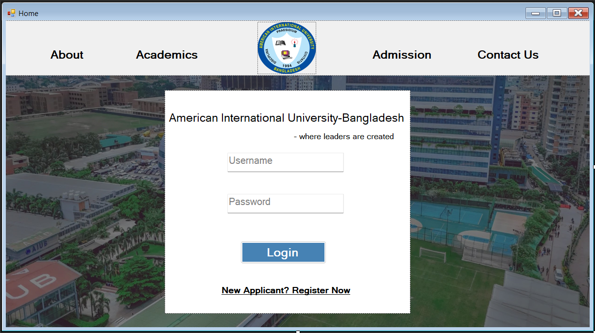

## Applicant registration: personal information

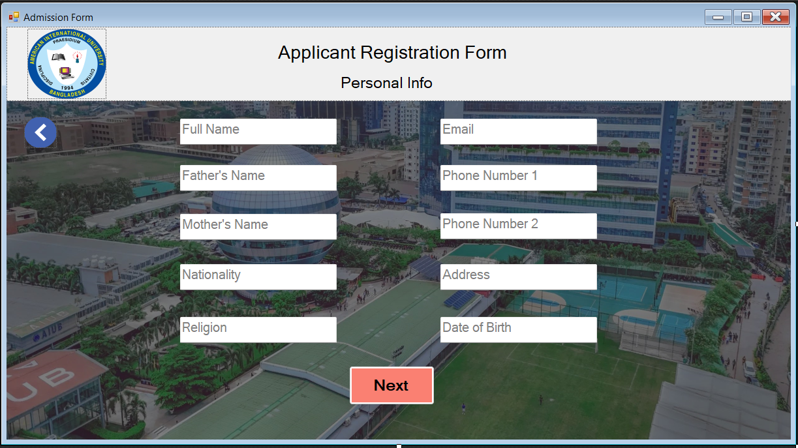

## Applicant registration: academic details

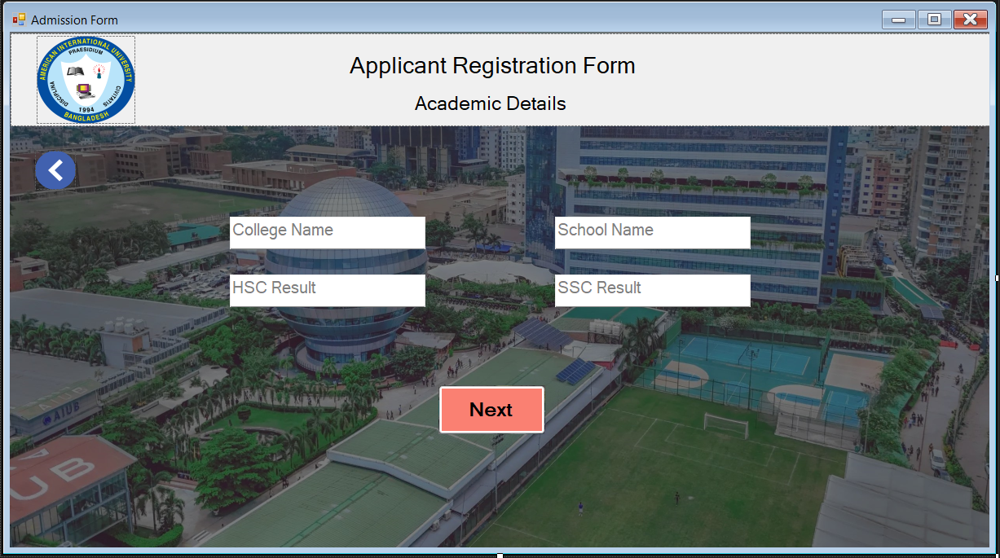

## Applicant registration: password

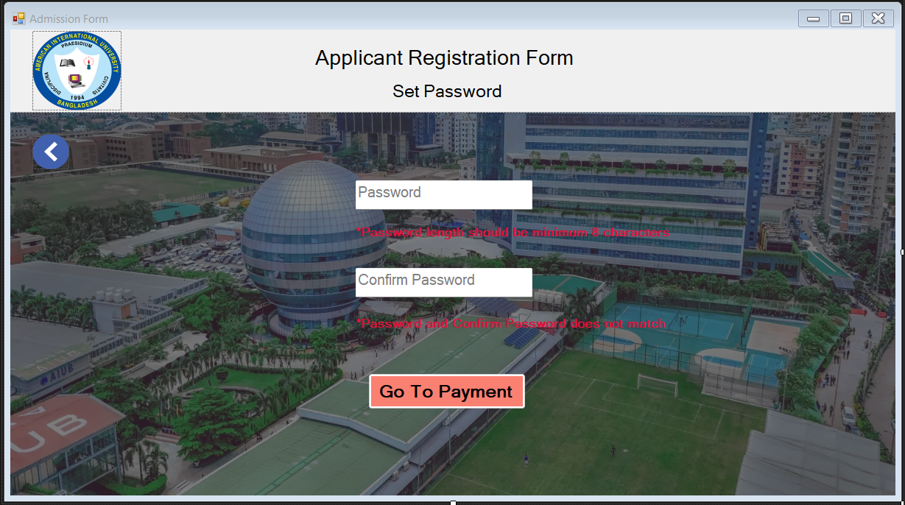

## Applicant registration: payment

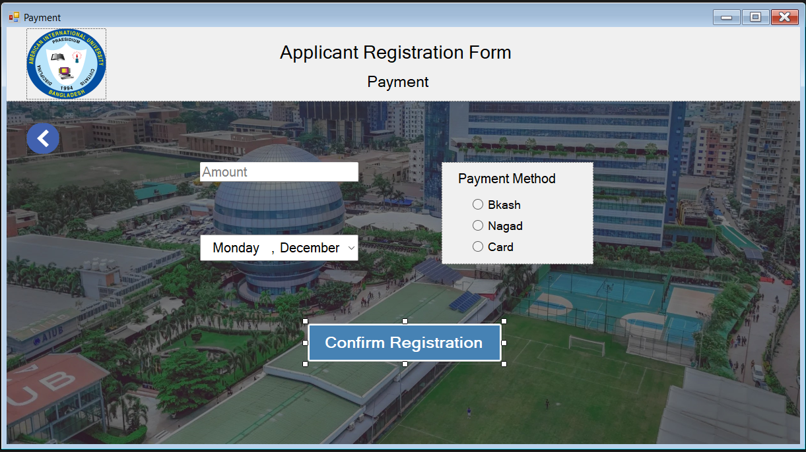

## Admin dashboard: application review

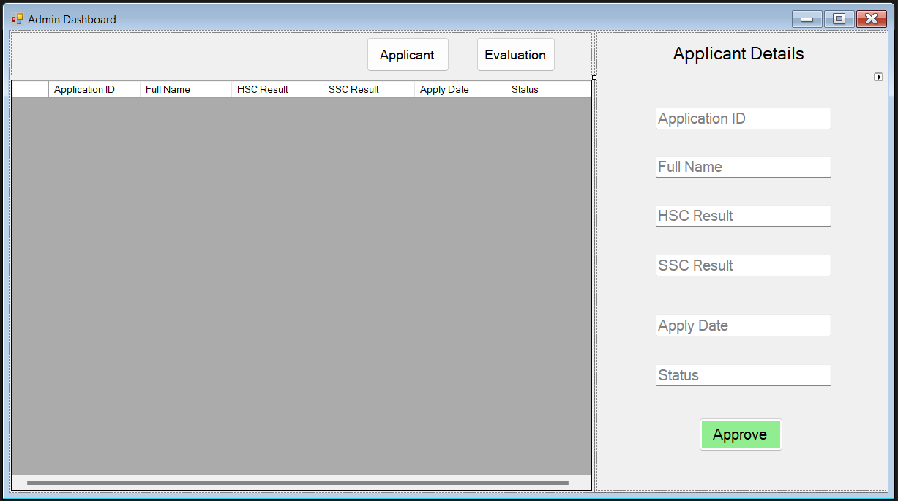

## Admin dashboard: evaluation publication

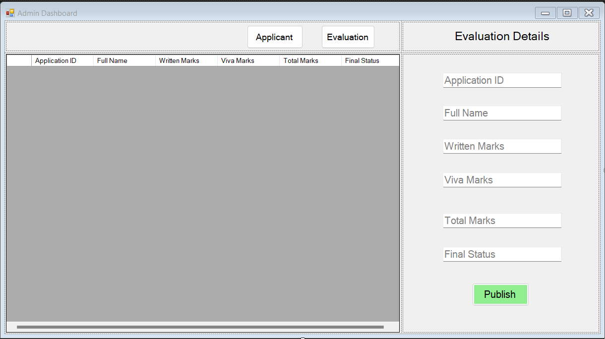

## Teacher dashboard: evaluation

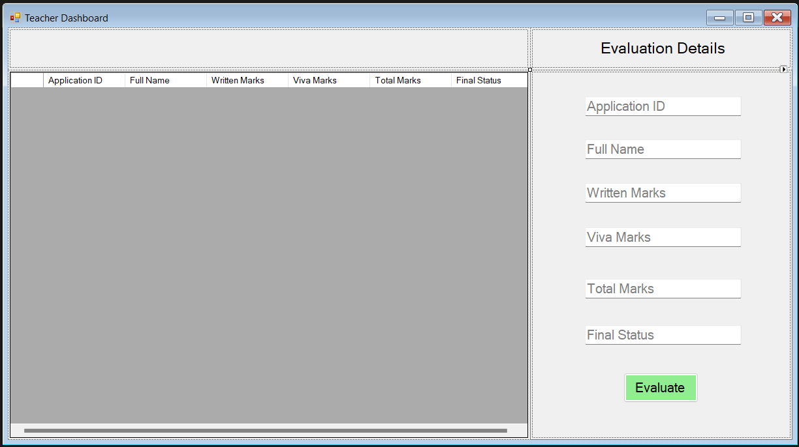

## Applicant dashboard: admission result

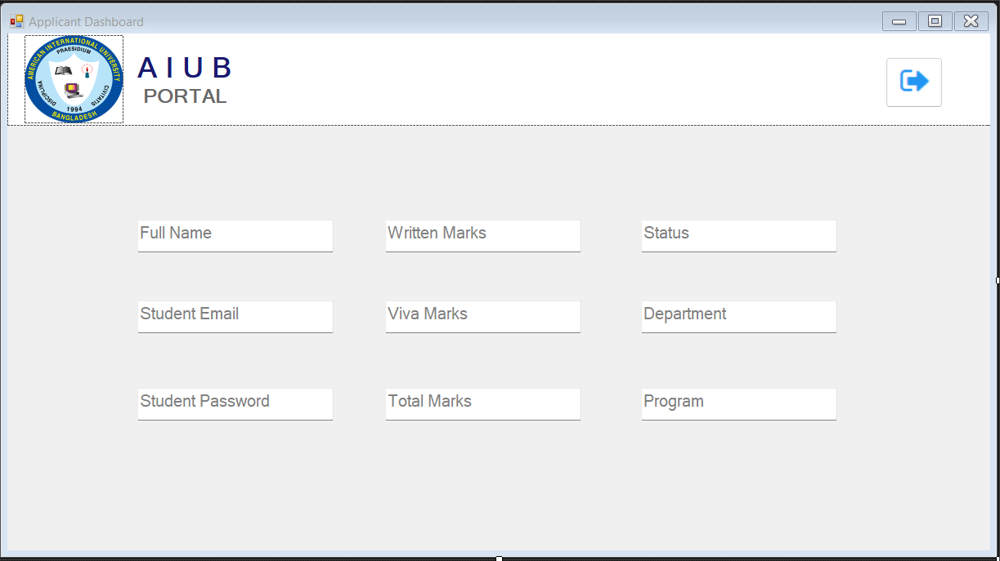

## Academic departments and programs

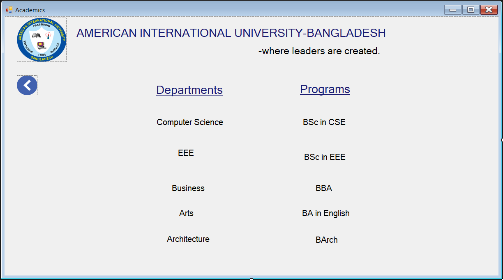

## Admission information

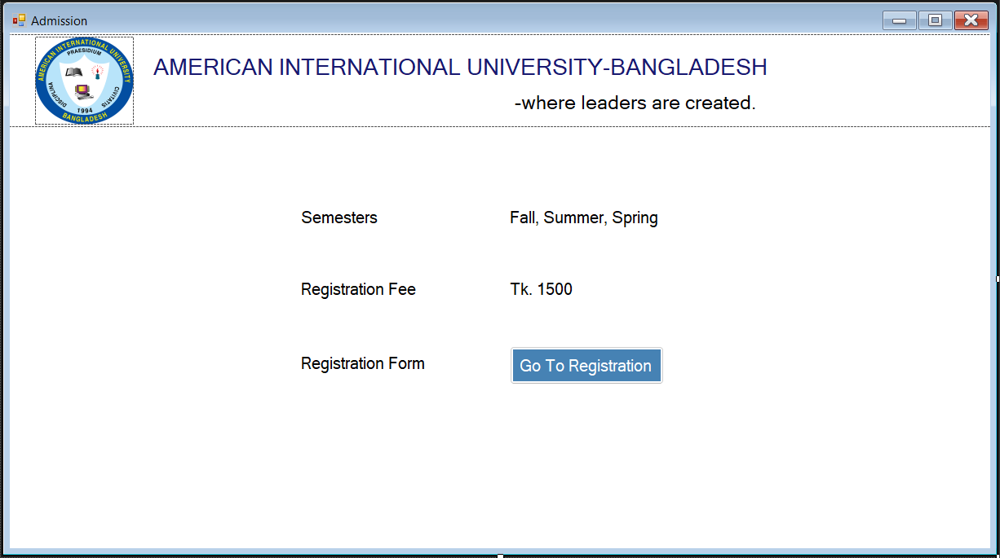

## About the university

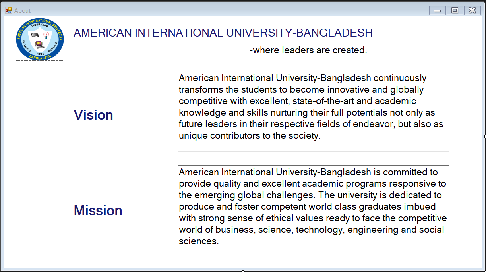

## Contact information

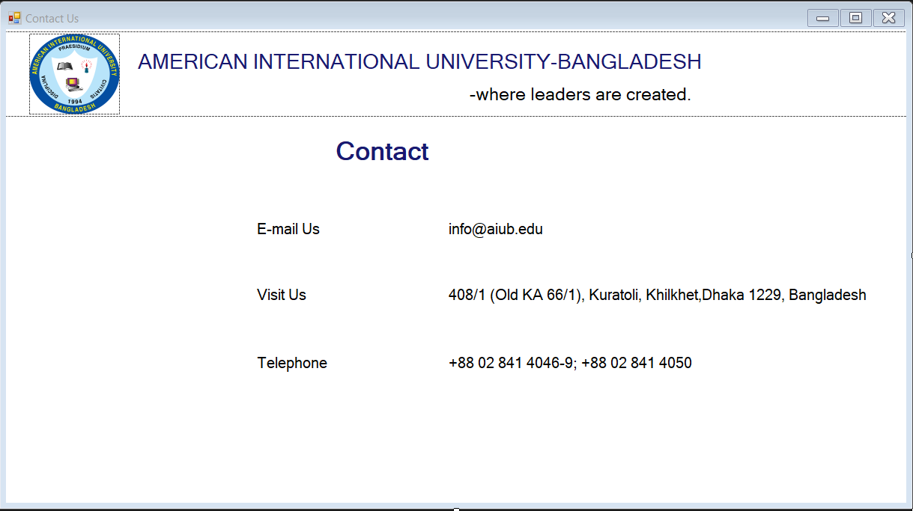
